# ARKM Forensics & AI Studio Agent Workflow Reference

**Document Reference**: `QT-WORKFLOW-DIAG-01`  
**Purpose**: Structural blueprints and workflow gap analysis for on-chain investigations and AI Studio multi-agent execution pipelines.

---

## 1. End-to-End ARKM Forensic Investigation Workflow

This flowchart maps the primary operational sequence from raw transaction ingestion to institutional SAR delivery.

```mermaid
flowchart TD
    subgraph S1["Stage 1: Infiltration & Ingestion"]
        A[Raw Blockchain Transaction Input] --> B[Address Extraction & Network Identification]
        B --> C[Ultra Clustering & Arkham Label Lookup]
        C --> D{Known Entity?}
        D -- Yes --> E[Attach Entity Dossier & Historical Balance]
        D -- No --> F["⚠️ GAP: Unlabeled / New Address Heuristics"]
    end

    subgraph S2["Stage 2: Obfuscation & Hop Tracing"]
        E --> G[Trace Capital Outflows]
        F --> G
        G --> H[Peel Chain & Split Analysis]
        H --> I{Mixer or Bridge Detected?}
        I -- Yes --> J["⚠️ GAP: Unmixing Protocol (Tornado/Railgun Routing)"]
        I -- No --> K[Direct Multi-Hop Transfer DAG]
        J --> L[Cross-Chain Bridge Recovery Analysis]
        K --> M[Exchange Gateway Identification]
        L --> M
    end

    subgraph S3["Stage 3: Gateway Interception & Resolution"]
        M --> N[CEX Hot Wallet & Deposit Address Confirmation]
        N --> O{Liaison Endpoint Available?}
        O -- Yes --> P[Dispatch Freeze Notice to Binance/Coinbase/Kraken Desk]
        O -- No --> Q["⚠️ GAP: Private/Offshore Exchange Subpoena Delay"]
        P --> R[SAR Evidence Pack Compilation]
        Q --> R
        R --> S[Final Delivery: Client & Legal Counsel]
    end

    classDef gap stroke:#f59e0b,stroke-width:2px,fill:rgba(245,158,11,0.15);
    class F,J,Q gap;
```

---

## 2. AI Studio Multi-Agent Coordination Pipeline

This diagram illustrates how specialized agents interact via AI Studio APIs to synthesize data without processing bottlenecks.

```mermaid
sequenceDiagram
    autonumber
    actor User as Investigator / Client
    participant AI_Studio as AI Studio API Gateway
    participant Librarian as Librarian Agent (Indexing)
    participant Analyzer as ARKM Forensics Engine
    participant Compliance as Compliance & SAR Drafter

    User->>AI_Studio: Submit Investigation Query (Wallet / Tx Hash)
    AI_Studio->>Librarian: Request Historical Dossiers & Entity Cache
    Librarian-->>AI_Studio: Return Labeled Entities & Past Precedents
    
    rect rgb(20, 30, 50)
        Note over AI_Studio, Analyzer: Core Forensic Processing
        AI_Studio->>Analyzer: Ingest Transaction Flow & Hop Vector
        Analyzer->>Analyzer: Trace Counterparties & Exchange Deposits
        Analyzer-->>AI_Studio: Return Flow Topology & Recovery Score
    end

    rect rgb(30, 20, 40)
        Note over AI_Studio, Compliance: Evidentiary Packaging
        AI_Studio->>Compliance: Structure Evidence against POCA/SAR Standards
        Compliance-->>AI_Studio: Validated 24h Legal Dossier
    end

    AI_Studio-->>User: Complete Deliverable & Action Plan
```



---

## 3. Workflow Gap Analysis & Resolution Matrix

| Stage | Potential Operational Gap | Detection Method | Resolution Protocol |
| :--- | :--- | :--- | :--- |
| **Ingestion** | Unlabeled high-volume destination wallet | Absence of Arkham curated tag | Trigger heuristic clustering based on common gas sponsors and sweeping cadence. |
| **Tracing** | Split transactions entering multi-asset mixers | Rapid disintegration into uniform batch denominations | Flag transaction tree for secondary heuristic peel reconstruction. |
| **Interception** | Off-ramp into unregulated offshore platform | Unknown deposit contract schema | Cross-reference counterparty clusters against known liquidity provider bridges. |
| **Coordination** | Latency during multi-agent handoff in API | Request timeouts or token boundary limits | Stream intermediate JSON artifacts into persistent cache storage. |

---

*Visual workflows can also be interactively customized and modified using the Backoffice Workflow Builder at `http://localhost:3000/workflow_builder.html`.*
